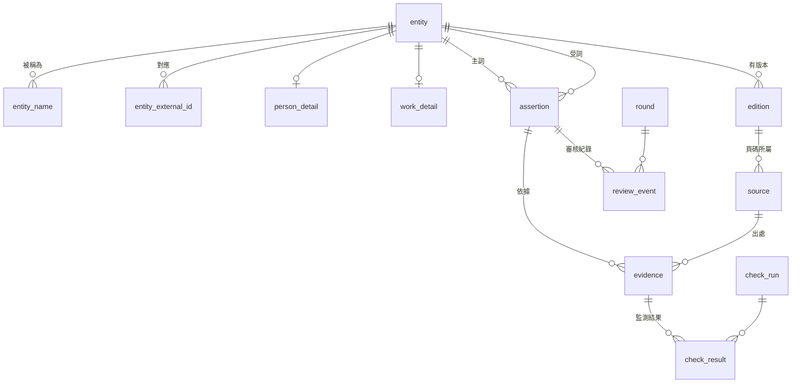
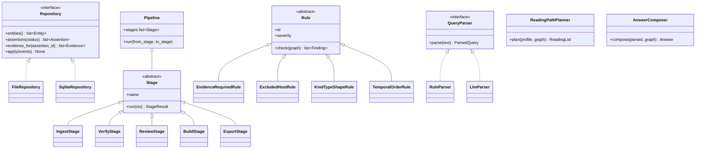
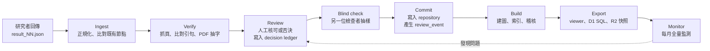
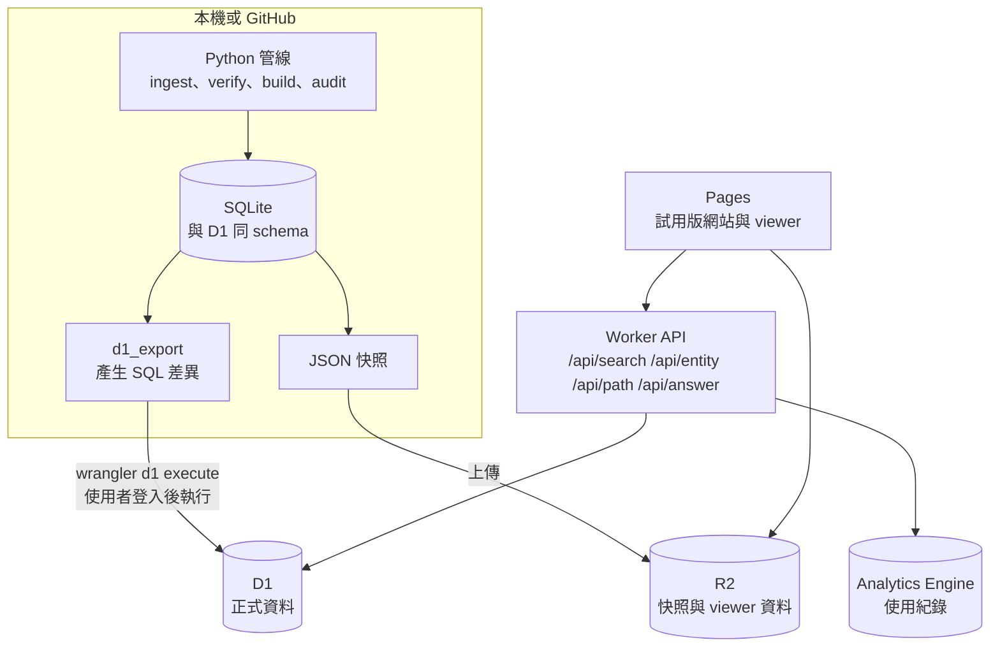

# 觀看的坐標 架構 v2 設計稿

最後更新：2026-11-17（初稿；同日依使用者決定：新增 `group` 類型、查詢 API 改用 TypeScript，兩項皆已實作）

本文件規劃下一版的程式結構、資料架構與部署方式。目標有三個：把反思（二）列出的改良方向（閱讀路徑、問句理解、理論深度、來源監測）放進一個能長期維護的結構；把資料從散落的 CSV、JSONL 與自由文字欄位整理成可查詢、可稽核的資料表；把資料與查詢服務搬到 Cloudflare，讓試用版網站與使用紀錄有固定的落腳處。

核心價值維持不變：每條關係都附來源與原文引句；回答時只查圖譜、不由語言模型臨場生成；未查證的內容不進正式圖。

## 1. 現況盤點

### 1.1 程式

| 項目 | 現況 | 問題 |
|---|---|---|
| 結構 | 18 支腳本放在 repo 根目錄與 `tools/`，共約 2,900 行；`data_io.py` 集中讀檔 | 每支腳本各自組裝流程，同一份邏輯（如圖譜載入、名稱顯示）散在多處；沒有套件邊界，難以單獨測試一段流程 |
| 每輪擴充 | 每輪複製一份 `compile_rNN.py`，把否決、改 claim、改角色寫成程式裡的字典 | 審核決定變成程式碼，無法查詢「第 26 輪否決了哪些、為什麼」；每輪腳本只在 scratchpad，換人就無法重現 |
| 查詢 | `query.py` 用 difflib 與程式內的別名表解析問句 | 1,000 題中超過一半對不到問題類型；別名放在程式裡，資料更新後要改程式 |
| 推薦 | `recommend.py` 從一個節點往外走一步並排序 | 沒有興趣與難度的輸入，輸出是關係清單 |
| 驗證 | `audit_data.py`、`source_monitor.py`、盲測與引句核對各自獨立 | 檢查結果寫進 Markdown 報告，沒有累積成可比較的歷史 |

### 1.2 資料（2026-11-17 實測）

以下數字由 `scratchpad/validate/consistency.py` 與 `scratchpad/v2/migrate_prototype.py` 對現行資料實際計算：

- 2,048 個節點、4,088 條關係（正式 3,786），來源 1,492 列
- `evidence` 是累加的自由文字，以「｜」分段：1,823 條關係有 5 段，158 條有 8 段以上；裡面共有 7,648 個帶日期的審核標記（核可 3,715、降級 836、改 claim 264、換源 153、剔除 27 等），以及 6,341 組「引句＋網址」，其中 2,253 組已被後來的來源取代
- `parse_evidence` 取最後一組網址與引句當作現行依據；37 條關係的現行網址與 `source_ref` 指向的網址不一致，多數只差結尾句點或分頁參數，代表網址沒有正規化
- `sources.csv` 有 4 列欄位數錯誤（說明文字含未加引號的逗號：ways_of_seeing、burning_desire、notes_index、new_topographics），讀檔時說明被截斷
- 9 條 `exhibit` 關係的對象是攝影團體（Kamoinge、f/64、V-10 等），團體目前被歸為 institution；另有美術館 `exhibit` 展覽事件的寫法，語意上應是「主辦」
- 名稱上沒有重複節點；兩組同名屬合理區分（決定性瞬間的概念與書、傑夫．沃爾其人與同名專書），代表解析問句時必須能依類型消歧
- 3,761 條有引句的正式關係中，275 條（7.3%）的引句沒有出現任一端節點的名稱，1,872 條只出現一端；這是粗略指標，用來決定下一次盲測的抽樣重點
- 節點沒有生卒年與出版年欄位，時序檢查只能從名稱裡抓年份，4 筆疑似時序矛盾全是誤報（標題裡的「1980 年代」是研究對象）
- 作品的度數中位數是 1，456 件作品只有一條邊（多半是作者邊）；閱讀路徑需要的作品屬性（難度、篇幅、是否有中譯）目前完全沒有
- 2 件中譯本把譯者記成作者（《觀看的方式》中譯本的吳莉君、《論攝影》中譯本的黃翰荻），其他譯本則用 contributor；角色清單缺少「譯者」
- 274 條正式關係的 claim 沒有中文（只寫年份或出版資訊，例如「1994」），439 條少於 8 個字；這類結構性關係（作者、參展）適合由模板產生說明文字，人寫的 claim 留給智識關係

結論：資料本身相當乾淨（外鍵 0 錯、沒有重複節點），問題集中在「結構」：審核歷史混在文字欄位、網址未正規化、缺少作品與人物的屬性、團體與主辦的語意沒有位置。

## 2. 設計原則

- 程式能做的交給程式，只有判斷交給 AI；回答階段完全不呼叫語言模型
- 資料是唯一真相：審核決定、別名、難度都存成資料，不寫在程式裡
- 審核紀錄只增不改（append-only）：狀態變更以事件累積，任何時點的圖譜都可重建
- 開放世界假設：圖譜沒有的關係代表「沒有資料」，不代表「不成立」；評估外部回答時同樣適用
- 一個類別一個職責、一個函式一件事；每個管線階段有明確的輸入與輸出，可以單獨重跑
- 本機與雲端用同一份 SQL schema（SQLite 與 Cloudflare D1 同方言），本機可完整重現雲端資料

## 3. 資料模型 v2

設計參考兩個成熟模型：Wikidata 的陳述模型（一個陳述有主值、修飾語、多筆參考與等級）與 W3C PROV-O（每份證據記錄它來自哪個來源、由哪個活動產生）。完整 SQL 見 `docs/schema-v2.sql`。



| 表 | 用途 | 與現況的差別 |
|---|---|---|
| `entity` | 節點；新增類型 `group`（攝影團體、藝術家團體）與 `region`、`merged_into` | 團體不再借用 institution；合併節點時保留舊 id |
| `entity_name` | 每個節點的所有寫法：繁簡、日文新舊字體、韓文、羅馬拼音、譯名、常見錯字；`norm` 欄存正規化鍵 | 別名表從 `query.py` 移出成為資料；問句解析直接查索引 |
| `entity_external_id` | Wikidata、VIAF、ULAN、NDL、國圖權威檔 | 之後做名稱比對與跨庫連結的基礎 |
| `person_detail`、`work_detail` | 生卒年；作品出版年、形式、難度 1–3、是否有中譯 | 閱讀路徑與時序檢查需要的屬性 |
| `edition` | 作品的版本（語言、譯者、出版社、年份、ISBN） | 頁碼屬於版本；《明室》中譯本與英譯本的頁碼可以並存 |
| `source` | 網頁、PDF、書、文章、掃描檔；`host` 與 `excluded_reason` | 網址正規化後存一次；不可用來源以欄位標示，稽核直接查 |
| `assertion` | 關係本身（主詞、述詞、受詞、角色、年份、claim、狀態、信心）；新增述詞 `hosted_by`（主辦）與 `prerequisite_for`（先讀），角色新增 `translator` | 一條關係一列，以雜湊當 id；`interpretive` 標記屬於我自己詮釋、需要專家確認的關係 |
| `evidence` | 一條關係可以有多份依據；每份有引句、頁碼或段落（`locator`）、直接程度、是否為現行依據 | 取代累加的自由文字；被取代的依據保留但標為非現行 |
| `round`、`review_event` | 每輪擴充，以及每一次核可、降級、否決、改 claim、換源的事件 | 取代 evidence 裡的 7,648 個方括號標記，也取代 `compile_rNN.py` 裡的否決字典 |
| `check_run`、`check_result` | 來源監測每次執行、每份依據的頁面狀態與引句狀態 | 監測結果可以跨月比較，找出「上個月還在、這個月不見」的引句 |

可行性已用原型驗證：`migrate_prototype.py` 把現行資料全數轉進這份 schema，4,088 條關係沒有一條被拒絕、外鍵 0 錯，SQLite 檔約 5 MB，只占 D1 免費額度（500 MB）的 1%。轉換後才看得到的問題（4 列格式錯誤的來源、37 條網址不一致、25 條正式關係沒有現行逐字引句）列在第 9 節的清理工作。

## 4. 程式架構

### 4.1 套件與檔案

```
coordinates/                     # 新套件；舊腳本在功能對齊前保留
  domain/        models.py       # Entity, Name, Assertion, Evidence, Source, ReviewEvent（pydantic）
                 vocab.py        # 述詞、角色、層級、類型的受控詞彙與中文標籤
  store/         repository.py   # Repository 介面
                 file_repo.py    # 讀寫現行 CSV/JSONL（過渡期）
                 sqlite_repo.py  # 本機 SQLite，與 D1 同 schema
                 d1_export.py    # 產生 D1 匯入用 SQL 與差異更新
  ingest/        batch.py        # ResearchBatch：讀研究者回傳的 result_NN.json
                 normalize.py    # 名稱、網址、引句標點正規化
                 ledger.py       # DecisionLedger：每輪的否決、修正寫成資料檔
  verify/        fetch.py        # PageFetcher（編碼偵測、重試、禮貌延遲）；BrowserFetcher（無頭 Edge 重開動態頁面）
                 pdf.py          # PdfText（抽字失敗時標記，交給人工或讀頁工具）
                 quotes.py       # QuoteMatcher（中日韓不計空格、標點對照）
                 monitor.py      # SourceMonitor：寫入 check_run / check_result
                 blind.py        # BlindSampler：抽樣、產生盲測包、回收結果
  quality/       rules.py        # Rule 基底類別；每條規則一個類別
                 shapes.yaml     # 類型限制（哪種述詞能連哪些類型），類似 SHACL 的形狀
                 audit.py        # Auditor：跑全部規則，輸出 Finding 清單
  graph/         builder.py      # GraphBuilder：從 repository 建 KnowledgeGraph
                 scoring.py      # 來源層級與信心分數
  eval/          external.py     # 外部平台回答的實體連結與比對
  export/        viewer.py, review_queue.py, checklist.py, snapshot.py
  cli.py                         # 單一入口：coord build / audit / ingest / monitor / export / eval
tests/                           # 依套件分資料夾；每個類別有單元測試，階段之間有契約測試
```

回答問題的部分（問句解析、名稱比對、答題模板、推薦與閱讀路徑）依 2026-11-17 的決定改用 TypeScript，放在 `api/`（第 11 節）；`coordinates/` 只負責建置管線，兩邊以圖譜快照（graph.json，之後是 D1）為介面。QueryParser（規則版與 LLM 版共用輸出格式）、AnswerComposer 的書單與比較模板、ReadingPathPlanner 都在 `api/` 實作。

### 4.2 主要類別



設計重點：

- **Repository 介面**：所有程式只透過介面讀寫資料。過渡期用 `FileRepository` 讀現行檔案，新舊兩邊建出的 `graph.json` 必須逐位元組相同才換到 `SqliteRepository`
- **Stage 與 Pipeline**：參考 Kedro 的節點、管線與資料目錄概念。每個階段宣告輸入與輸出、寫入 `build/` 的固定位置，可以從任一階段重跑；失敗時停在該階段並留下報告
- **Rule 類別**：現在 `audit_data.py` 裡的每項檢查各自成為一個類別，有編號與嚴重度（error / warning）。類型限制寫在 `shapes.yaml`，新增述詞時只改資料檔
- **QueryParser 介面**：規則版與 LLM 版輸出同一個 `ParsedQuery`（節點 id、問題類型、限制條件），經 pydantic 驗證才往下傳。LLM 版的結果以問句雜湊快取，同一題第二次不再呼叫模型，回答因此仍可重現

### 4.3 原型

`scratchpad/v2/proto/` 有一個可執行的最小原型：domain models、Repository 介面、`FileRepository`（讀現行檔案並把 evidence 文字拆成依據與審核事件）、`Pipeline` 與兩個階段（載入、稽核）、四條 Rule。對 11/16 的資料跑 9 項對齊測試全部通過：4,088 條關係一條不少、id 不重複、每條關係恰有一份現行依據且與舊的 `source_ref` 相同、正式圖數量不變；稽核階段找出 25 條缺現行逐字引句、9 條類型不符、274 條 claim 沒有中文，與第 1.2 節的分析一致。整個流程約 1 秒。

## 5. 處理管線



| 階段 | 輸入 | 輸出 | 自動或人工 |
|---|---|---|---|
| Ingest | 研究者 JSON | 標準化的提議關係、新節點候選、重複候選 | 自動 |
| Verify | 提議關係 | 每條引句的頁面狀態與比對結果；比對不到的另列清單 | 自動，PDF 亂碼與擋爬的頁面轉人工或讀頁工具 |
| Review | 提議關係＋驗證結果 | decision ledger（YAML）：核可、否決、改 claim、改角色及理由 | 人工 |
| Blind check | 抽樣 50 條 | 支持、部分支持、不支持；結果寫回 ledger | 另一位檢查者 |
| Commit | ledger | repository 新增列與 review_event | 自動 |
| Build | repository | `graph.json`、名稱索引、稽核報告 | 自動 |
| Export | 圖譜 | viewer、待查證佇列、D1 SQL、R2 快照 | 自動 |
| Monitor | 正式關係的依據 | check_result、差異報告 | 自動，每月一次 |

decision ledger 取代 `compile_rNN.py`：每輪一個檔案（例如 `ledger/round26.yaml`），內容只有決定與理由，由同一支程式套用。第 26 輪改為待查證、剔除、改 claim 與修正引句的每一項決定，都會變成檔案裡可查詢的資料。

## 6. 改良功能

### 6.1 個人化閱讀路徑

輸入是一份閱讀檔案：已讀過的作品或人物、想深入的概念、偏好的難度、是否只要有中譯的書。

1. **候選**：以已讀節點為起點跑 personalized PageRank，只走正式關係，得到與興趣相關的作品
2. **篩選**：依 `work_detail` 的難度與中譯欄位過濾；難度跳太多（例如從 1 直接到 3）時加入中間讀物
3. **排序**：以 `prerequisite_for` 與「延伸、批判、討論」關係推導先後順序，做拓撲排序；同一層依相關度排序
4. **輸出**：一份 3 到 6 本的書單，每本附推薦理由（從圖譜路徑產生的句子）與原文引句

難度由人標注，先標入門書單會用到的約 60 件作品；`prerequisite_for` 先由規則推導候選（例如 A 延伸自 B，就建議先讀 B），再由人確認，做法參考教育知識圖譜的先修關係研究（ACE，Aytekin & Saygın）。

### 6.2 問句理解

- 規則版先查 `entity_name` 的正規化索引，再用編輯距離處理錯字，依類型消歧
- 規則版解析不出節點或問題類型時，才交給 LLM 版；LLM 只輸出節點 id 與問題類型的 JSON，不寫答案
- 每一題的解析結果與來源（規則或 LLM）都記錄下來；回答仍由 `AnswerComposer` 依模板組成
- 驗收：以 1,000 題問題集量測問題類型一致率與節點解析率，目標把錯字與中英夾雜問法的一致率提高到 80%

### 6.3 理論深度與頁碼級引用

- `evidence.locator` 存頁碼或段落，`source.edition_id` 指到版本
- 先完成《明室》與《論攝影》：各選定一個中譯本與一個英譯本建 `edition`，51 條待回原典的關係補頁碼後移出待查證
- `assertion.interpretive` 標出 36 條屬於我自己詮釋的關係，作為請益專家的清單

### 6.4 來源監測

- `SourceMonitor` 每月對全部正式關係的依據跑一次，結果寫入 `check_run`、`check_result`
- 與上一次比較，列出新出現的失效頁、消失的引句、改版的頁面；任何退回待查證的決定仍由人做，寫成 review_event
- PDF 先用 pypdf 抽字；抽出亂碼或檔案過大時標為 `unchecked`，進人工清單（第 26 輪已確認《二十一世紀》、北美館館刊、東京都寫真美術館紀要都屬這類）
- 一般請求判不出來的頁面（拒絕自動請求、本機憑證失敗、內容由 JavaScript 載入）交給 `BrowserFetcher`：以無頭 Edge、獨立暫存設定檔重開，文字少於 300 字視為驗證頁（例如 Cloudflare 的等待頁）而非內容；11/17 的全量驗證已用這個做法跑過一次
- 非 ASCII 的網址路徑先編碼再送出（11/17 發現 5 個日文、中文檔名的網址因此被誤判為連不上，已修正）

### 6.5 使用紀錄

依先前決定，試用版網站的使用紀錄放 Cloudflare，回饋表單用 Google 表單。每次查詢記錄：時間、問句、解析出的節點與問題類型、解析來源（規則或 LLM）、回傳的節點、使用者是否點開出處。不記錄姓名與聯絡方式。

## 7. Cloudflare 部署



| 元件 | 用途 | 依據 |
|---|---|---|
| D1 | 正式資料（第 3 節的 schema）；Worker 以索引查詢 | 免費方案每日 500 萬列讀取、10 萬列寫入、單庫 500 MB；2026-09-01 起免費方案超過每日上限時查詢會失敗，儲存的資料不受影響。現行資料約 5 MB，每次查詢以索引讀取數十列，遠低於上限 |
| R2 | 每次發布的 JSON 快照、viewer 資料 | 保留每版完整快照，方便回溯 |
| Worker | 讀取 API，TypeScript（`api/src/worker.ts`） | Workers 原生語言；圖譜快照每個 isolate 從 R2 讀一次並留在記憶體；本機量測 1,000 題作答共約 3.3 秒，平均每題約 3 ms（免費方案每次請求 CPU 上限 10 ms） |
| Pages | 試用版網站與 viewer | 靜態檔案 |
| Analytics Engine | 使用紀錄（查詢、點擊出處） | Worker 內建寫入 API，SQL 查詢 |

建圖、驗證、稽核都留在本機執行：這些步驟要抓網頁、跑 PDF、需要人工審核，不適合放在請求路徑上。雲端只負責讀取與記錄。發布流程是本機產生 SQL 差異檔，由使用者登入 wrangler 後執行；帳號、API token 與登入都由使用者處理。

### 7.1 第一版部署（2026-11-18 實作）

上表是目標架構。第一版先用一個 Worker 完成試用版網站需要的部分，減少要建立的資源與設定步驟：

| 部分 | 第一版做法 | 與目標架構的差別 |
|---|---|---|
| 網站與 viewer | Worker 的 static assets（`api/public/`，由 `tools/build_cloudflare.py` 與 `npm run site` 產生） | 不另開 Pages 專案；同一網址，紀錄端點不需要跨來源設定 |
| 回答 | 查詢程式打包成 `engine.js` 在瀏覽器執行，讀同一份 `graph.json` | 網站不呼叫 API，免費方案每次請求 10 ms CPU 的上限不影響網站 |
| `/api/answer` | Worker 從 static assets 讀快照後作答，供外部嵌入與外掛測試 | 不用 R2；冷啟動載入快照超過 10 ms，免費方案下第一次呼叫可能失敗 |
| 使用紀錄 | D1 `seeing-coordinates-log`（沿用 11/15 的 events、rate 兩表、同意後才記錄、每日限流） | 以 D1 取代 Analytics Engine，可直接用 SQL 匯出與刪除 |
| 資料 | D1 `seeing-coordinates-data`，由 `tools/export_d1.py` 依第 3 節 schema 匯出（約 2.6 萬列、6 MB） | 目前是可查詢的副本；回答仍讀快照，v2 管線完成後改由 D1 產生快照 |

部署步驟見 `docs/deploy-cloudflare.md`；Worker 的路由、紀錄驗證與 `/api/answer` 有 7 項測試（`api/test/worker.test.ts`）。

## 8. 驗證框架

品質維度參考 Linked Data 品質評估文獻（Zaveri 等）與知識圖譜精煉文獻（Paulheim）的分類，對應到本專案的具體檢查：

| 維度 | 檢查 | 方式 |
|---|---|---|
| 正確性 | 引句在頁面上、引句支持 claim | 來源監測（自動）、盲測（另一位檢查者）、名稱出現率（粗篩） |
| 出處 | 每條正式關係有現行逐字引句與可用來源 | Rule：EvidenceRequired、ExcludedHost |
| 一致性 | 述詞連接的類型正確、無自我迴圈、時序合理 | shapes.yaml、TemporalOrderRule（需要第 3 節的年份欄位） |
| 完整性 | 每件作品有作者、每個概念有提出者、東亞節點的度數 | 稽核報告的涵蓋率指標 |
| 時效 | 網址仍可讀、引句仍在 | 每月監測與差異報告 |
| 可重現 | 同一題多次回答相同 | 回歸測試與 1,000 題問題集 |

Paulheim 把檢查分成只用圖譜本身的內部方法，與借助外部資料的外部方法。本專案目前以外部方法為主（回到網頁比對引句）；第 3 節的年份與類型欄位補齊後，內部方法（時序、類型、度數異常）可以先篩出可疑關係，減少人工負擔。

## 9. 遷移計畫

| 階段 | 內容 | 驗收 |
|---|---|---|
| 0 清理 | 修 4 列格式錯誤的來源、正規化 37 條網址、補 25 條缺現行逐字引句的正式關係或降為待查證（其中 9 條已找到出處，待核可）、9 條 exhibit 改用 group 或 hosted_by、2 條譯者改用 translator 角色 | 稽核錯誤 0、警告不增加 |
| 1 骨架 | 建 `coordinates/` 套件、domain models、`FileRepository`、`Pipeline` 與 `cli.py`；舊腳本改呼叫新套件 | 新舊兩邊建出的 graph.json 逐位元組相同；test_core 36 項全過 |
| 2 正規化 | 把 evidence 文字拆成 evidence 與 review_event（原型已驗證可行）；`SqliteRepository` 上線 | 從 SQLite 重建的 graph.json 與舊版相同；7,648 個審核標記全數轉成事件 |
| 3 管線 | Ingest、Verify、Review、Commit 階段與 decision ledger；第 27 輪起不再寫 compile 腳本 | 用新管線重跑第 26 輪，結果與現行資料相同 |
| 4 雲端 | D1 匯出、Worker 讀取 API、Pages、Analytics Engine | 試用版網站可查詢；查詢紀錄寫入 |
| 5 功能 | 閱讀路徑、LLM 問句解析、頁碼級引用、每月監測排程 | 1,000 題一致率、5 位使用者測試的門檻 |

每個階段單獨提交，前一階段驗收通過才進下一階段；舊腳本保留到第 2 階段驗收後才移除。

## 10. 決定與待決定

已決定（2026-11-17）：

- **團體的類型**：新增 `group`，只收以共同名義創作、展出或發表主張的創作者團體；協會、通訊社、獎項、美術館維持 institution。已把 24 個節點改為 group（f/64、攝影分離派、Provoke 同人、卡莫因格工作坊、V-10、四月影會、新線會、前衛寫真協會、芦屋カメラクラブ、北京光社等）。推薦排序沿用 institution 的權重 0.5，所以這次改動不影響任何回答
- **Worker 語言**：TypeScript。查詢層已移植到 `api/`（第 11 節），並以 1,000 題逐字比對確認與 Python 版回答完全相同；之後問句理解的改良直接在 TypeScript 版進行，Python `query.py` 保留為比對用的參考實作，直到 TypeScript 版加入新功能、兩者不再需要一致為止

待決定：

- **難度標注**：由專案負責人親自標注約 60 件入門作品，或先由 AI 提議、專案負責人逐筆確認
- **Cloudflare 帳號**：由專案負責人建立並登入；免費方案即可開始，流量變大再評估付費方案

## 11. TypeScript 查詢層（已實作）

```
api/src/
  domain/    vocab.ts（類型、述詞、角色、層級與中文標籤）、types.ts
  graph/     KnowledgeGraph.ts（保留 networkx 的插入順序）、UndirectedGraph.ts（networkx 雙向 BFS）
  text/      pystr.ts（Python 字串語意）、difflib.ts（SequenceMatcher、get_close_matches、CloseMatcher）
  query/     EntityResolver.ts、IntentClassifier.ts、QueryEngine.ts
  recommend/ Recommender.ts
  render/    renderers.ts
  io/        graphSource.ts（檔案或 R2）、csv.ts、paths.ts
  eval/      answers.ts、runQuestions.ts、parity.ts
  cli.ts、worker.ts
```

- **逐字一致**：Python 版有幾個會影響回答的細節，都照原樣移植：networkx 的邊與鄰居順序、雙向 BFS 的走法、difflib 的比對分數與同分排序、Python 的浮點數與 None 印法。`parity.ts` 對 1,000 題比對意圖、解析出的節點、回答全文的 sha256 與引用網址，四項全部相同
- **效能**：模糊比對改為依字元重疊預先篩選並快取每個片段的結果，分數與排序與 difflib 相同；1,000 題作答時間由約 107 秒降到約 3 秒
- **測試**：8 項單元測試，fixture 由 Python 的 difflib（303 組字串，含觸發 autojunk 的長字串）與 networkx（60 組最短路徑）產生

## 參考資料

課程與教材

- Stanford CS520 Knowledge Graphs（課程講義：知識圖譜的定義、從結構化資料與文字建圖）：https://web.stanford.edu/class/cs520/
- Hogan et al., "Knowledge Graphs", ACM Computing Surveys, 2021：https://arxiv.org/abs/2003.02320
- Kedro 概念（節點、管線、資料目錄、modular pipeline）：https://docs.kedro.org/en/stable/getting-started/glossary/

資料模型與出處

- Wikibase 資料模型（陳述、修飾語、參考、等級）：https://www.mediawiki.org/wiki/Wikibase/DataModel/Primer
- W3C PROV-O：https://www.w3.org/TR/prov-o/
- W3C SHACL：https://www.w3.org/TR/shacl/

品質與驗證

- Paulheim, "Knowledge Graph Refinement: A Survey of Approaches and Evaluation Methods", Semantic Web 8(3), 2017：https://www.semantic-web-journal.net/content/knowledge-graph-refinement-survey-approaches-and-evaluation-methods
- Zaveri et al., "Quality Assessment for Linked Data: A Survey", Semantic Web 7(1), 2016：https://semantic-web-journal.net/content/quality-assessment-linked-data-survey
- Splink（Fellegi-Sunter 機率式紀錄連結，供重複節點比對參考）：https://pypi.org/project/splink/

閱讀路徑

- Aytekin & Saygın, "ACE: AI-Assisted Construction of Educational Knowledge Graphs with Prerequisite Relations", Journal of Educational Data Mining：https://distantreader.org/stacks/journals-ojs/jedm/jedm-737.htm

Cloudflare

- D1 限制：https://developers.cloudflare.com/d1/platform/limits/
- D1 計價：https://developers.cloudflare.com/d1/platform/pricing/
- D1 免費方案上限自 2026-09-01 起強制執行：https://developers.cloudflare.com/changelog/post/2026-09-01-d1-free-tier-limit-enforcement/
- Python Workers 正式推出（2026-09-21）：https://blog.cloudflare.com/python-workers-ga/
- 從 Python Worker 查詢 D1：https://developers.cloudflare.com/d1/examples/query-d1-from-python-workers/
- Workers Analytics Engine：https://developers.cloudflare.com/analytics/analytics-engine/
